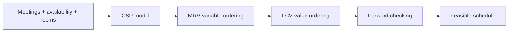

# Ai Constraint Scheduler

[](https://www.python.org/) [](#testing) [](LICENSE)

> Generate conflict-free meeting schedules with CSP search and constraint-propagation heuristics.

## Why this project exists

A team needs to schedule meetings while satisfying participant availability, room capacity, and conflict constraints.

The implementation is intentionally small and reproducible so the underlying AI reasoning is easy to inspect, benchmark, and discuss.

## AI concepts demonstrated

Constraint Satisfaction Problems, backtracking, MRV, LCV, forward checking, constraint propagation, search statistics

## Architecture



## Results

| Metric | Demo result |
|---|---:|
| Meetings scheduled | 4 / 4 |
| Search nodes explored | 5 |
| Backtracks | 0 |
| Valid schedule | Yes |

## Project structure

```text
ai-constraint-scheduler/
├── README.md
├── LICENSE
├── requirements.txt
├── examples/
│   └── demo.py
├── src/
│   └── implementation
└── tests/
    └── test_*.py
```

## Run locally

```bash
python -m venv .venv
# macOS/Linux
source .venv/bin/activate
# Windows PowerShell
# .venv\Scripts\Activate.ps1

pip install -r requirements.txt
python examples/demo.py
```

## Testing

```bash
PYTHONPATH=. pytest -q
```

## Ideas for extending the project

- Scale the environment or dataset and compare runtime and search behavior.
- Add richer visualizations or an interactive interface.
- Introduce additional baselines and ablation experiments.
- Add configuration files so experiments are reproducible from the command line.

## Portfolio note

This project is independently structured and documented as a portfolio implementation inspired by AI concepts studied in CS221. Do not publish course-provided starter code, solutions, tests, or restricted materials.

## GitHub metadata

**Repository name**

`ai-constraint-scheduler`

**Description**

`Generate conflict-free meeting schedules with CSP search and constraint-propagation heuristics.`

**Topics**

`artificial-intelligence` `constraint-satisfaction` `csp` `backtracking` `optimization` `search-algorithms` `python` `cs221`
